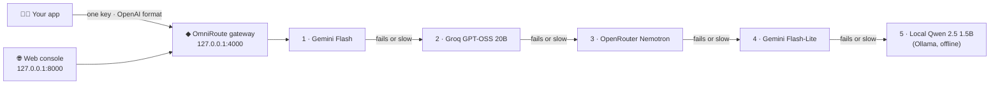

# ◆ OmniRoute

### One API for every AI model. When a provider fails, the next one answers.


OmniRoute is a self-hosted AI gateway. Your apps send one OpenAI-compatible request with one key.
OmniRoute picks a provider, switches to the next one the moment a provider fails or stalls, and
ends on a **local model that runs on your own computer** so it still answers with no internet at all.
Every answer reports which provider served it, how long it took, the tokens used and the cost.

---

## ✨ Highlights

| | |
|---|---|
| 🔀 **Automatic failover** | Gemini → Groq → OpenRouter → Gemini Lite → local model. Nothing is shown to the user as an error while a backup is available. |
| 🔌 **One API, many models** | OpenAI-compatible `/v1/chat/completions`. Switch models by changing a name, not your code. |
| 🖥️ **Works offline, too** | A small local model (Qwen 2.5 1.5B via Ollama, ~1 GB) answers when the internet or every provider is down. |
| 🔍 **Routing trace** | See every hop live: who was called, who failed, who answered. |
| 🧪 **Resilience test** | Flip a switch to force a provider to fail and watch recovery happen in real time. |
| 📊 **Analytics** | Requests, outages absorbed, average latency, total cost, requests per provider and a request log. |
| 🔐 **Keys stay private** | Provider keys live only on the gateway. Apps use a single gateway key. |
| 🪟 **Windows offline pack** | A zip with Python, packages, Ollama and the model, so it installs with no internet. |

## 🧭 How a request flows



| # | Model | Where it runs | Timeout |
|---|---|---|---|
| 1 | Gemini Flash (`gemini-flash-latest`) | Google, cloud | 10 s |
| 2 | GPT-OSS 20B (`openai/gpt-oss-20b`) | Groq, cloud | 20 s |
| 3 | Nemotron 3.5 Lightning, free (`nvidia/nemotron-3.5-lightning:free`) | OpenRouter, cloud | 30 s |
| 4 | Gemini Flash-Lite (`gemini-flash-lite-latest`) | Google, cloud | 30 s |
| 5 | Qwen 2.5 1.5B (`qwen2.5:1.5b`) | Your computer, via Ollama | 90 s |

The chain is defined in [`config.yaml`](config.yaml). Change the order or add a provider there.

## 🚀 Quick start

You need an **API key** for any cloud provider you want (all are free to get):
[Gemini](https://aistudio.google.com/apikey) · [Groq](https://console.groq.com/keys) · [OpenRouter](https://openrouter.ai/keys).
The local model works without any keys.

### Windows: one click

1. Unzip the folder, for example to the Desktop.
2. Double-click **`START-HERE.bat`**. The first run installs everything (3 to 5 minutes) and creates `.env`.
3. Optional: open `.env` in Notepad and paste your keys.
4. The console opens at **http://127.0.0.1:8000**.

If Windows blocks the scripts, run this in PowerShell from the folder:
```
powershell -ExecutionPolicy Bypass -File setup.ps1
powershell -ExecutionPolicy Bypass -File start.ps1
```

### macOS / Linux

```bash
ollama pull qwen2.5:1.5b   # local backup model, one time (install Ollama from ollama.com first)
bash setup.sh              # creates .venv and installs LiteLLM, then fill in .env
bash start.sh              # starts the gateway and opens the console
```

Ollama must be running for the local backup. The Ollama app starts it for you; otherwise run `ollama serve`.

### Windows offline pack (no internet needed to install)

The `OmniRoute-windows` zip includes the Python 3.12 installer, all 118 LiteLLM packages for Windows,
portable Ollama and the Qwen model. Copy it to the Desktop, unzip, and run `START-HERE.bat`.
About 6 GB free disk space is needed once unpacked.

## 🖱️ Using the console

1. Pick a **model** in the panel: *Smart routing* (recommended) or one specific model.
2. Type a message and press **Enter**. Each answer shows its provider, latency, tokens and cost.
3. Watch the **routing trace** for each hop: green answered, red failed, grey not needed.
4. Turn on the **Resilience test** and send a message: the selected provider is forced to fail, and the next one answers.
5. Scroll to **Analytics** for the session totals and the request log.

The status bar at the top shows whether the gateway is online and whether the **local backup is ready**.

## 💻 Command-line client

With OmniRoute running:
```bash
.venv/bin/python cli.py                  # three sample questions (Windows: .venv\Scripts\python)
.venv/bin/python cli.py "your question"  # one question
.venv/bin/python cli.py --chat           # interactive chat
.venv/bin/python cli.py --each           # the same question to every model
```

## ⚙️ Configuration

- **Models and fallbacks:** [`config.yaml`](config.yaml). Each `model_list` entry reads its key from `.env`
  (`api_key: os.environ/NAME`). Add its name to the `fallbacks` list to put it in the chain.
- **Keys:** [`.env.example`](.env.example) is the template. Copy it to `.env`. Never commit `.env`.
- **Ports:** gateway `4000`, console `8000`, Ollama `11434`.

## 🧩 Project structure

```
OmniRoute/
├── START-HERE.bat          Windows one-click start
├── setup.ps1 / setup.sh    Create .venv, install LiteLLM, unpack Ollama (Windows)
├── start.ps1 / start.sh    Start Ollama, the gateway and the console
├── config.yaml             Models, timeouts and the fallback chain
├── requirements.txt        Python dependency (LiteLLM proxy)
├── .env.example            Key template (copy to .env)
├── app/
│   ├── ui_server.py        Console back end (port 8000)
│   └── index.html          Console front end (single file)
└── cli.py                  Command-line client
```

## 🛠️ Troubleshooting

- **Console says "Gateway offline":** the gateway takes 30 to 60 seconds to start. Check its window for errors.
- **"Local backup offline":** Ollama isn't running, or the model isn't downloaded. Run `ollama pull qwen2.5:1.5b`.
- **Answers keep coming from the local model:** the cloud providers are failing or their keys are empty. Check `.env`.
- **Authentication error from one provider:** that key is wrong or empty. The other providers still answer.
- **Port already in use:** close the old OmniRoute windows, or restart the computer.
- **Windows script won't run:** use the `powershell -ExecutionPolicy Bypass -File ...` commands above.

## 🔒 Security notes

- `.env` holds your keys and is ignored by git. Don't share it, and don't paste it into issues.
- The gateway and console listen only on `127.0.0.1`, so other computers on your network can't reach them.
- The **Resilience test** flag (`dangerously_allow_mock_testing_request_params` in `config.yaml`) is for local demos.
  Turn it off before running OmniRoute anywhere other people can reach.

## 🧱 Built with

[LiteLLM proxy](https://github.com/BerriAI/litellm) for routing · [Ollama](https://ollama.com) with Qwen 2.5 for the offline backup ·
Python standard library for the console server and CLI · plain HTML, CSS and JavaScript for the console.
